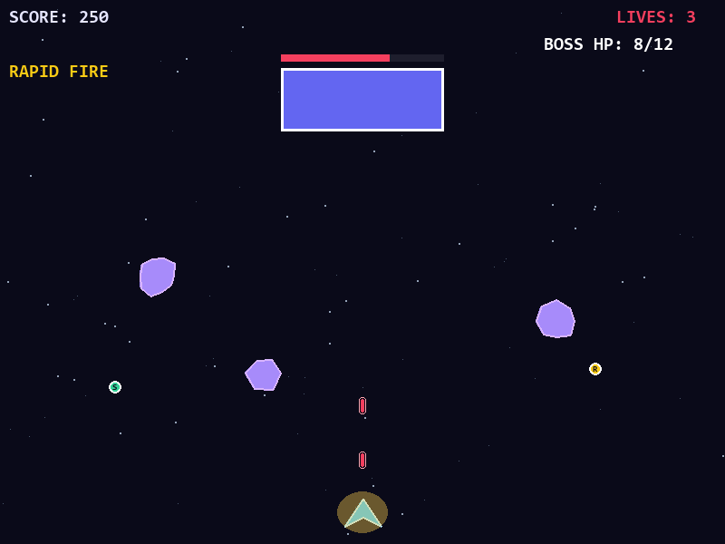

# Cyberpunk Space Shooter

A small arcade-style space shooter built with Python and Pygame.



## Features

- Move the ship, dodge meteors, and shoot with lasers.
- Collect shield, rapid-fire, and health power-ups.
- Fight bosses that appear as your score increases.
- Get brief invulnerability after a collision.
- Track your high score locally.

## Requirements

- Python 3
- Pygame 2.6.1 or later

Install Pygame:

```powershell
python -m pip install pygame
```

## Run

From the project directory:

```powershell
python main.py
```

## Controls

| Key | Action |
| --- | --- |
| Left Arrow / A | Move left |
| Right Arrow / D | Move right |
| Space | Start, shoot, or resume |
| Escape | Pause or return to the menu |

The local high score is stored in `space_highscore.txt`. It is excluded from Git.
